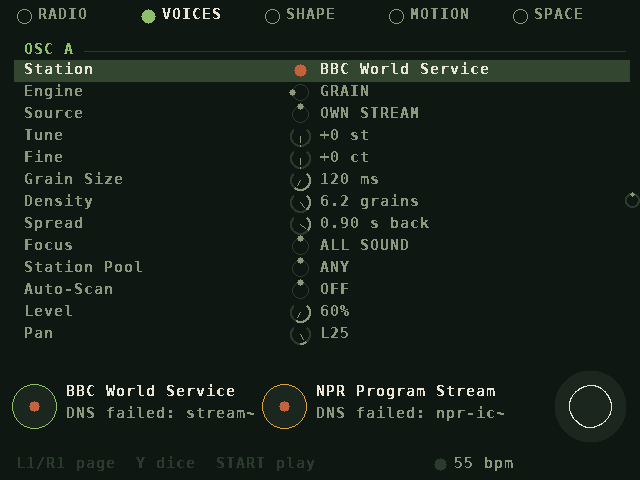
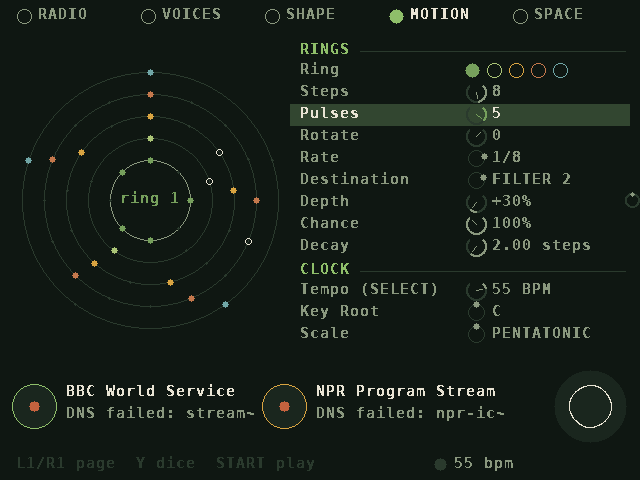

# RadioScan

A synthesizer for the **Miyoo Mini Plus** (OnionOS) whose sound sources are **internet radio streams**.
Two stations at a time become two voices. Each voice reshapes its broadcast with one of four engines, then the
result runs through hybrids, filters, a wavefolder, rhythmic gates, delay and a long reverb. Five Euclidean
rings, chance and drift keep it moving. It's designed for ambient performance and quiet, meditative listening.


## What it does

- **Streams are the oscillators.** Each voice has a station and an engine:
  - **LIVE** plays the broadcast directly, with optional sample-rate and bit crushing.
  - **LOOP** grabs a slice of the stream and replays it at any pitch.
  - **WAVE** turns a few milliseconds of the stream into a single-cycle wavetable played at the note's pitch. It
    keeps re-grabbing at its *Scan Rate*, so the timbre drifts with the broadcast.
  - **GRAIN** is a granular cloud scattered over the last few seconds of the stream.
  - **Source** lets a voice play its own stream, the other voice's stream, or both.
  - A simple **tone oscillator** (sine, triangle, saw, square) can be mixed into each voice. It's a clean carrier
    for the vocoder and ring mod. It's off by default.
- **Voices or music.** A real-time detector listens to each stream and judges speech against music. Set a
  voice's **Focus** to *VOICES ONLY* or *MUSIC ONLY* and only matching material is recorded, so a grain cloud
  can be built purely from talk radio while the station plays songs. Stations are also tagged
  **voice / music / sound**. Auto-scan and station hops can stay inside one **Station Pool**, and with auto-scan
  on, a voice leaves stations that never match its focus.
- **Hybrids:** vocoder (A speaks through B, or B through A), *A shapes B* (envelope follower), cross-fold,
  ring mod, and B→A audio-rate FM.
- **Shaping:** state-variable filter (LP/BP/HP/notch), wavefolder (sine, triangle, multi), ladder filter
  (LP24/LP12/BP/HP) with drive, VCA envelope (drone or gated), LFO, ping-pong delay, and a 5-line FDN reverb
  with decays up to 60 s and a freeze.
- **Rhythmic gates per voice:** a Euclidean pattern at a tempo-synced rate. Every pulse is shaped by attack,
  length, release and curve (soft swells to sharp chops), with depth and per-step chance.
- **Motion:** **five Euclidean rings** (steps, pulses, rotation, rate, destination, depth, chance, decay).
  Destinations: filters, fold, pitch, levels, A↔B crossfade, ring mod, reverb, delay. Rings can also fire
  events: generative notes from the scale, fresh grabs, or a hop to another station in the pool.
- **Chance:** five slow random-walk drifters, reverse-grain chance, octave jumps, pitch scatter, and dice to
  randomise the sound, the motion, or one section, or to gently mutate everything.
- **Tap tempo** (SELECT) drives the rings, gates, arpeggiator, LFO sync and delay sync.
- **Stations:** 35 are preloaded and you can add more three ways:
  1. Edit `stations.txt` on the SD card (`Name|URL|voice|music|sound`).
  2. Type a URL on the on-screen keyboard (RADIO page, **Y**).
  3. **Scan** the free [radio-browser.info](https://www.radio-browser.info) directory by genre (grouped into
     voices / sound / music), by name, or at random, then audition results on either voice and save them (RADIO
     page, **R2**).
- **HTTPS** through a built-in mbedTLS with Mozilla's CA bundle. Certificate dates are ignored because handheld
  clocks are often wrong, but chain and hostname are still checked. Also handles HTTP, ICY metadata (song titles),
  redirects, and `.pls` / `.m3u` playlists.

The visual design is circles throughout: knobs, rings, pads. It follows the number five (five pages, five
rings, five drifters, pentatonic and other five-note scales, 5/16 and 5/8 note values) and a forest palette of
moss, lichen, bark, leaf, autumn amber and birch.

| | |
|---|---|
|  |  |
|  |  |

## Install

1. Download `RadioScan-miyoo` from the latest [Actions build](../../actions) (or a Release) and unzip it.
2. Copy the `RadioScan` folder to `/mnt/SDCARD/App/` (so you have `App/RadioScan/launch.sh`).
3. Make sure Wi-Fi is on in OnionOS, then open **Apps → RadioScan**.

`log.txt` in the app folder records errors if something goes wrong.

## Controls

**PLAY** (the home screen)

| Button | Action |
|---|---|
| D-pad + A B X Y | eight notes of the current scale (labels on screen) |
| L1 / R1 | octave down / up |
| L2 | grab fresh slices from both streams |
| hold R2 + D-pad | shape: up/down = light/dark (filter), left/right = calm/weird (fold) |
| R2 + A / B / X / Y | dice: new sound / new motion / hop stations / mutate gently |
| SELECT | tap tempo |
| START | go to EDIT |
| MENU twice | quit |

**EDIT** (five pages: RADIO, VOICES, SHAPE, MOTION, SPACE)

| Button | Action |
|---|---|
| L1 / R1 | previous / next page |
| Up / Down | choose a row; Left / Right change it (hold B for fine steps) |
| A | play the root note |
| X / L2 | grab |
| Y | roll the dice on the selected section |
| SELECT | tap tempo |
| START | back to PLAY |

**RADIO page:** A sends the selected station to OSC A and B sends it to OSC B. Y adds a URL, X deletes (press
twice), L2 sets the station's kind (voice / music / sound), and R2 scans the directory.

## Building

The Miyoo build uses the OnionOS toolchain image:

```sh
docker run --rm -v "$PWD":/root/workspace aemiii91/miyoomini-toolchain:latest bash -lc \
  'cd /root/workspace && make package \
     CROSS=/opt/miyoomini-toolchain/usr/bin/arm-linux-gnueabihf- \
     SYSROOT=/opt/miyoomini-toolchain/usr/arm-linux-gnueabihf/sysroot'
# -> dist/RadioScan.zip
```

If Docker Hub rate-limits you, `mirror.gcr.io/aemiii91/miyoomini-toolchain:latest` is the same image.

Desktop build for development (needs SDL 1.2 headers, e.g. `libsdl1.2-dev` or `libsdl1.2-compat-dev`):

```sh
make
RADIOSCAN_DIR=App/RadioScan ./build/desktop/radioscan
```

Keyboard on desktop, matching the Miyoo's key codes:

| Keys | Buttons |
|---|---|
| arrows | D-pad |
| Space / L-Ctrl / L-Shift / L-Alt | A / B / X / Y |
| E / T | L1 / R1 |
| Tab / Backspace | L2 / R2 |
| R-Ctrl / Enter / Esc | SELECT / START / MENU |

### Testing without the internet

`tools/fake_icecast.py` generates a speech-like and a music-like MP3 stream and serves them the way Icecast
does: ICY metadata, a redirect, a `.pls` playlist, a fake directory, and optional HTTPS with a throwaway CA.
`radioscan --render <seconds> <out.wav> [param=value ...]` runs both streams through the synth offline.
It reports level, the voice/music verdict for each stream, and DSP cost. CI runs this on every push.

## Settings

All parameters are saved to `settings.cfg` in the app folder. `launch.sh` has a few switches:

- `RS_RATE`: internal engine rate (32000 by default; 22050 saves CPU).
- `RS_BUFFER`: audio buffer size (raise it to 2048 if you hear crackles).
- `RS_ROTATE180`: set to 1 if the picture is upside down on your firmware.
- `RS_AUDIOSERVER`: set to 0 to stop OnionOS's audio server while RadioScan runs, if you get no sound.

## Performance

The engine runs at 32 kHz. On the desktop the full engine takes 1.3–2.5% of one 2.1 GHz Xeon core. That
suggests roughly 10–20% of one Cortex-A7 core on the Mini Plus, plus a few percent for each MP3 decoder,
leaving plenty of headroom on the dual-core chip. Denormals are flushed to zero in the audio thread so long
reverb tails stay cheap.

## Limitations

- MP3 streams only. AAC, Ogg/Opus and HLS (`.m3u8`) stations are skipped or reported as unsupported. The
  directory scan only lists MP3 stations.
- Station URLs change over time. If a preset stops working, remove it (X twice on the RADIO page) or scan for
  a replacement.
- The voice detector uses simple speech features (pauses between syllables, fricative bursts). It works well on
  clear talk against dense music, but a sparse solo instrument or a busy talk show can fool it.
- It hasn't been tested on real hardware yet. The audio-server handling in `launch.sh` and the screen
  orientation are the parts most likely to need a tweak; both are switches.

## Credits

- [minimp3](https://github.com/lieff/minimp3) (CC0) for MP3 decoding.
- [Mbed TLS](https://github.com/Mbed-TLS/mbedtls) (Apache-2.0) for HTTPS.
- CA certificates from Mozilla via [certifi](https://github.com/certifi/python-certifi) (MPL-2.0).
- Font rendered from DejaVu Sans Mono (Bitstream Vera license).
- Station directory: [radio-browser.info](https://www.radio-browser.info), a free community database.
