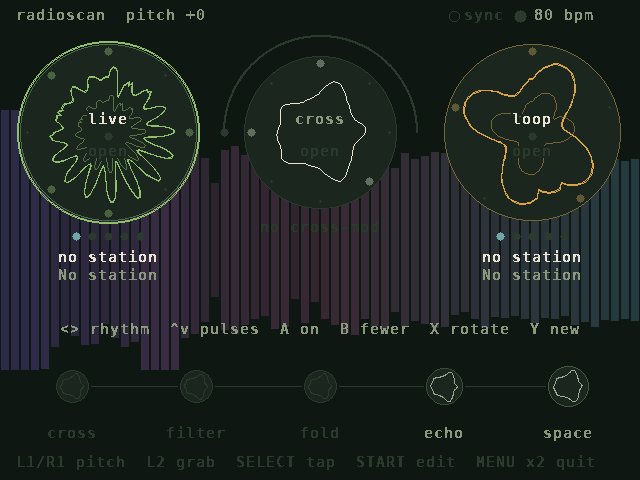
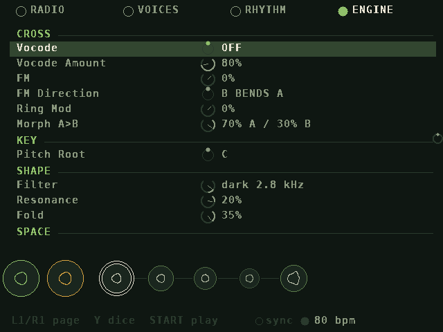
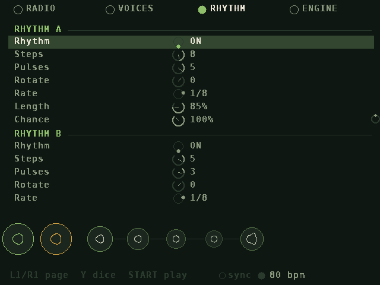
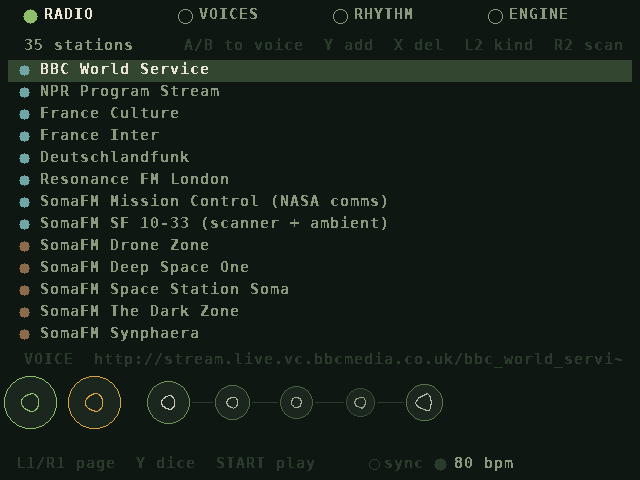
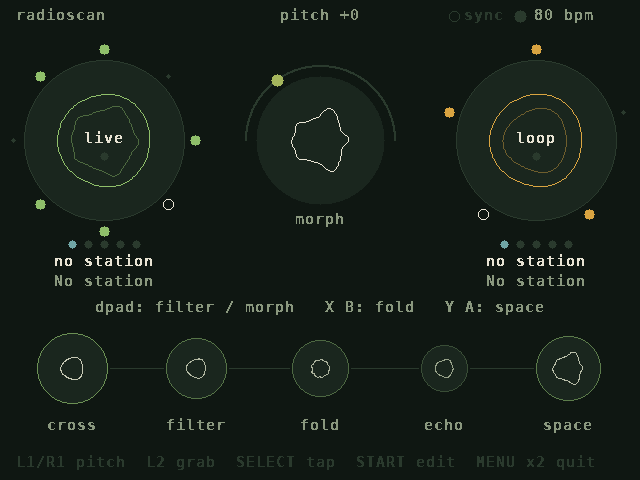
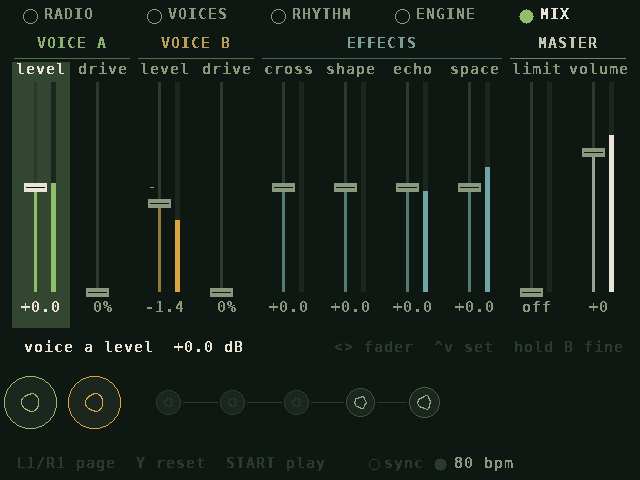

# RadioScan

A rhythm instrument for the **Miyoo Mini Plus** (OnionOS) played with **internet radio**.
Two stations become two voices. Each voice is opened and closed by its own Euclidean rhythm, the two can
cross-modulate each other (vocode, FM, ring mod, spectral morph), and the result runs through a filter,
a wavefolder, echo and space.



## How it works

- **Two radio voices.** Each voice plays one station with one of four engines:
  - **LIVE:** the broadcast as it is (the default for voice A), with an optional sample-rate crush.
  - **LOOP:** a slice of the stream, replayed at the voice's pitch; every rhythm pulse restarts it (the default
    for voice B).
  - **WAVE:** a few milliseconds of the stream as a pitched waveform that keeps re-scanning the broadcast.
  - **GRAIN:** a cloud of grains from the last moments of the stream.

  Each voice has its own **level**, **drive** and **pan**. **Focus** can make a voice listen only to speech or only to
  music; either voice can play any station. An optional **oscillator** (sine,
  triangle, saw or square) can be mixed into each voice for a cleaner tone or a carrier for cross-modulation.
  It's off by default; the radio comes first.
- **Two rhythms.** Each voice has a Euclidean rhythm that decides when it sounds: steps, pulses, rotate, rate
  and chance, and a gate shape (attack, length, release) from soft swells to sharp chops. With the rhythm off,
  the voice plays continuously. A third, **cross rhythm** brings the cross-modulation (morph, vocode, ring,
  FM) in on its pulses, with the same controls and gate shape; off, the cross stage stays on as set. All three
  rhythms are played directly on the PLAY page, as on hi5. Tap tempo (SELECT) and Wi-Fi sync drive them all.
- **Cross-modulation.**
  - **Vocode:** A speaks through B, or B through A, with 5, 8, 13, 21 or 34 bands.
  - **FM:** one voice bends the other's pitch.
  - **Ring mod.**
  - **Morph:** blends the two voices' spectra from A toward B.
  - **Converse:** whichever voice is talking holds the floor and the other ducks. When the speaker pauses and
    the other station is talking, the floor passes over, so two broadcasts take turns like an overheard
    dialogue. It's made for two speech stations, but works on anything.
- **Sound.**
  - **Filter:** one knob from dark (low-pass) through open to thin (high-pass), plus resonance.
  - **Bass** and **treble** shelves.
  - **Drive** (warm saturation), **fold**, and **crush** (fewer bits, lower sample rate).
  - **Echo** (a dotted-eighth ping-pong), **space** (reverb) and **stereo width**.
  - **Volume**, a **limiter**, and a leveller that keeps the overall loudness steady so the radio comes through
    clearly.
- **Mix.** One page of faders with live meters: each voice's level and drive, how loud each effect comes back
  (cross, shape, echo, space), the limiter and the master volume.
- **Stations.** 35 are preloaded and you can add more three ways:
  1. Edit `stations.txt` on the SD card (`Name|URL|voice|music|sound`).
  2. Type a URL on the on-screen keyboard (RADIO page, **Y**).
  3. **Scan** the free [radio-browser.info](https://www.radio-browser.info) directory by genre, by name or at
     random, then audition results on either voice and save them (RADIO page, **R2**).

  HTTPS works through a built-in mbedTLS, along with ICY song titles, redirects and `.pls` / `.m3u` playlists.

## The screen

The PLAY page is for performing: the two rhythms and the sound, live.

- **Voice circles (left A, right B).** Each voice's waveform is wrapped around its circle like a polar
  oscilloscope, swinging out and in with the signal: faint and small inside for the raw broadcast, bright and wide
  outside for the voice as it sounds. Each is scaled to its own recent peak, so a quiet station still swings wide,
  and the outer one opens and closes with the voice's rhythm. Five dots underneath show how speech-like the
  station is.
- **Rhythm rings.** Each voice wears its rhythm around its rim: coloured pulses, a white ring on the current step,
  and pulses/steps under the engine name. The cross rhythm circles the centre the same way.
- **Spectrum backdrop.** A soft frequency spectrum of the overall sound behind the circles. Its colour follows
  frequency, from indigo in the bass through rose in the mids to sky blue in the highs, hues kept apart from the
  voices' green and amber.
- **Converse.** The voice holding the floor gets a bright ring.
- **Centre.** The final sound, with the cross rhythm around it. The dot travelling over the top shows the morph
  position, from A on the left to B on the right. Underneath, each active cross effect is spelled out (like
  *A talks thru B*, *morph 40% to B*, *B bends A pitch*, *A talks, B waits*), with a bar showing its set amount
  and, brighter, how much of it the cross rhythm and the MIX return let through right now.
- **Five circles along the bottom:** *cross → filter → fold → echo → space*. Each grows the more it changes
  the sound.
- **Abstract forms.** The centre and the five stage circles are driven by the sound rather than drawn as a waveform:
  - Loudness swells the core.
  - Brightness adds petals (3, 5, 8, 13, 21) and spin.
  - Spiky sound sharpens the petals.
  - Attacks send out ripples.
  - In the fold circle the petals bend through the folder itself.

The EDIT pages (**RADIO, VOICES, RHYTHM, ENGINE, MIX**) hold every setting. A strip at the bottom shows the voices
and the five stages, with the stage you're editing ringed.

| | |
|---|---|
|  |  |
|  |  |
|  | |

## Install

1. Download `RadioScan.zip` from the latest [Release](../../releases) (or the `RadioScan-miyoo` artifact of an
   [Actions build](../../actions)) and unzip it.
2. Copy the `RadioScan` folder to `/mnt/SDCARD/App/` (so you have `App/RadioScan/launch.sh`).
3. Make sure Wi-Fi is on in OnionOS, then open **Apps → RadioScan**.

With the card mounted on a computer, `make install SD=/path/to/card` copies the built app into `App/`.

## Controls

**PLAY** (performance)

The three rhythm rings (voice A, cross in the middle, voice B) are played like hi5's pattern cells. The selected
ring is outlined, and every change shows its pattern briefly, like `A  E(5,8) >2  1/8`.

| Button | Action |
|---|---|
| D-pad left / right | select the rhythm: voice A, cross or voice B |
| D-pad up / down | more / fewer pulses |
| A | rhythm on / off (off = the voice plays continuously) |
| B | fewer pulses, wrapping back to all |
| X | rotate |
| Y | a new random pattern |
| hold L2 + up / down | steps |
| hold L2 + left / right | rate (right = faster) |
| hold L2 + Y / X | gate length shorter / longer |
| hold L2 + A | start / stop the rhythms (stopped, voices with a rhythm on are quiet; start begins on the downbeat) |
| tap L2 | grab a fresh slice for the selected voice (both voices when the cross rhythm is selected) |
| hold R2 + D-pad | up/down: filter brighter / darker; left/right: morph toward A / B |
| hold R2 + X / B | fold more / less |
| hold R2 + Y / A | space less / more |
| R2 + L1 / R1 / SELECT | dice: new rhythms / new sound / hop both stations |
| L1 / R1 | pitch down / up an octave (LOOP, WAVE and GRAIN voices) |
| SELECT | tap tempo |
| START | go to EDIT |
| MENU twice | quit |

**EDIT** (RADIO, VOICES, RHYTHM, ENGINE, MIX)

| Button | Action |
|---|---|
| L1 / R1 | previous / next page |
| Up / Down | choose a row; Left / Right change it (hold B for fine steps) |
| X / L2 | grab a fresh slice for the voice of the selected setting (both when it isn't a voice setting) |
| Y | roll the dice on the selected section |
| SELECT | tap tempo |
| START | back to PLAY |

**MIX page:** faders in four groups: VOICE A and VOICE B (a level fader with a drive knob under it), EFFECTS
(cross, shape, echo and space return levels) and MASTER (limiter, volume). Left / Right step through the controls
(each voice's drive knob comes right after its fader), Up / Down set the selected one (hold B for fine steps), and
Y puts it back to its default. Levels are shown in dB; the tick on each track is unity
(0 dB), and faders go up to +6 dB. Each meter shows its signal after the fader; the limiter's meter shows
how much it is turning the sound down. An effect's return level sets how loud it comes back, while its amount on
the ENGINE page still sets its character (echo feedback, reverb length, how hard the folder works). The limiter
goes from off to an 18 dB threshold, with the output made back up to just under full scale.

**RADIO page:** A sends the selected station to voice A and B sends it to voice B. Y adds a URL, X deletes
(press twice), L2 sets the station's kind (voice / music / sound), and R2 scans the directory.

## Wi-Fi sync

RadioScan shares its clock with other units on the same Wi-Fi network that speak the same sync protocol.
Set it under **RHYTHM → CLOCK → Wi-Fi Sync**:

| Setting | Behavior |
|---|---|
| AUTO (default) | Syncs whenever another unit is around; the lowest-numbered unit leads |
| LEAD | Always leads when present |
| FOLLOW | Never leads; waits for a leader |
| OFF | Runs alone and sends nothing |

The leader sets the tempo; tap tempo on the leader and every follower jumps to the new downbeat. Followers
nudge their clock speed by up to 3% to stay in phase, typically within a few milliseconds. Sync moves RadioScan's
two rhythms and the echo time; the radio streams themselves just keep playing. If the leader stops its
transport, followers hold their rhythms too.

The badge next to the tempo shows the state: an empty ring while searching, then *lead* or *follow* once
linked. Each unit sends 32 bytes ten times a second, so sync adds almost nothing on top of the two radio
streams. All units must be on the same network, and the network must allow devices to see each other. Guest
networks and some public Wi-Fi block this; a phone hotspot works well and also gives the radio its internet.

## Building

The Miyoo build uses the OnionOS toolchain image:

```sh
docker run --rm -v "$PWD":/root/workspace aemiii91/miyoomini-toolchain:latest bash -lc \
  'cd /root/workspace && make package \
     CROSS=/opt/miyoomini-toolchain/usr/bin/arm-linux-gnueabihf- \
     SYSROOT=/opt/miyoomini-toolchain/usr/arm-linux-gnueabihf/sysroot'
# -> dist/RadioScan.zip
```

If Docker Hub rate-limits you, `mirror.gcr.io/aemiii91/miyoomini-toolchain:latest` is the same image.

Desktop build for development (needs SDL 1.2 headers, e.g. `libsdl1.2-dev` or `libsdl1.2-compat-dev`):

```sh
make
RADIOSCAN_DIR=App/RadioScan ./build/desktop/radioscan
```

Keyboard on desktop, matching the Miyoo's key codes:

| Keys | Buttons |
|---|---|
| arrows | D-pad |
| Space / L-Ctrl / L-Shift / L-Alt | A / B / X / Y |
| E / T | L1 / R1 |
| Tab / Backspace | L2 / R2 |
| R-Ctrl / Enter / Esc | SELECT / START / MENU |

### Releasing

Any of these builds, tests and publishes a GitHub Release with `RadioScan.zip` attached (notes come from
`.github/release-notes.md`):

- **Actions → build → Run workflow**, with a tag such as `v0.2.0` filled in.
- Push a version tag: `git tag v0.2.0 && git push origin v0.2.0`.
- Create a release on the GitHub website; the zip is added to it automatically.

### Testing without the internet

`tools/fake_icecast.py` generates a speech-like and a music-like MP3 stream and serves them the way Icecast
does: ICY metadata, a redirect, a `.pls` playlist, a fake directory, and optional HTTPS with a throwaway CA.
`radioscan --render <seconds> <out.wav> [param=value ...]` runs both streams through the synth offline.
It reports level, the voice/music verdict for each stream, and DSP cost.

`radioscan --synctest LEAD|FOLLOW|AUTO [bpm] [seconds]` runs only the clock and Wi-Fi sync, then prints
whether it found peers, who led and how far apart the units ended up. Run two or more on the same network.

CI runs both on every push.

## Settings

All parameters are saved to `settings.cfg` in the app folder, including when OnionOS powers off. When a new
version changes the sound defaults, older settings keep their stations but start from the new sound.

`launch.sh` uses the same setup as the sibling apps HI5 and Jaffedrone, which mirror Onion's own GMU launcher.
It stops Onion's audio server while RadioScan runs, uses Onion's MI_AO/MI_GFX-backed SDL 1.2, sets the
performance CPU governor, and keeps the device awake. It has a few optional switches:

- `RS_BUFFER`: audio buffer size (raise it to 2048 if you hear crackles).
- `RS_RATE`: engine rate (48000 by default, the hardware's native rate; 32000 is lighter on the CPU).
- `RS_ROTATE180`: the picture is turned 180° for the Mini Plus panel by default; set it to 0 if your screen
  shows it upside down.

## Performance

The engine runs at 48 kHz. On the desktop it takes about 1–3% of one 2.1 GHz Xeon core (vocode and morph are
the heaviest). That suggests roughly 10–25% of one Cortex-A7 core on the Mini Plus, plus a few percent for each MP3 decoder,
leaving plenty of headroom on the dual-core chip. Denormals are flushed to zero in the audio thread so long
reverb tails stay cheap.

## Limitations

- MP3 streams only. AAC, Ogg/Opus and HLS (`.m3u8`) stations are skipped or reported as unsupported. The
  directory scan only lists MP3 stations.
- Station URLs change over time. If a preset stops working, remove it (X twice on the RADIO page) or scan for
  a replacement.
- The voice detector uses simple speech features (pauses between syllables, fricative bursts). It works well on
  clear talk against dense music, but a sparse solo instrument or a busy talk show can fool it.
- First hardware test: the screen orientation and the low volume are fixed in this version.

## Credits

- [minimp3](https://github.com/lieff/minimp3) (CC0) for MP3 decoding.
- [Mbed TLS](https://github.com/Mbed-TLS/mbedtls) (Apache-2.0) for HTTPS.
- CA certificates from Mozilla via [certifi](https://github.com/certifi/python-certifi) (MPL-2.0).
- Font rendered from DejaVu Sans Mono (Bitstream Vera license).
- Station directory: [radio-browser.info](https://www.radio-browser.info), a free community database.
